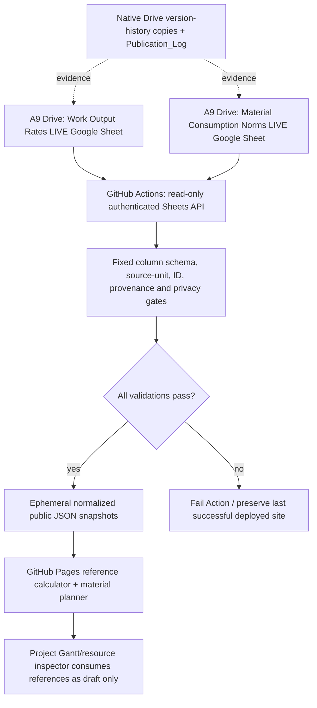

# A9 Skyforge — Google Sheets source registers and governed Pages publication

**Date:** 12 November 2026 (Asia/Kathmandu)  
**Repository:** `FabinGurung/jp-scheduling-resources-management`  
**Development/Pages source branch:** `kernel-v0.2-open-source-engines` (not `main`)  
**Public pages:** `/work-items/productivity.html` and `/work-items/materials.html`  
**Safety level:** reference coefficients only; no actual BOQ, signed construction quantities, private personal records, or work release.

## Ownership decision

**Google Drive is the editable authority for the TWO reusable engineering reference registers.** GitHub owns engine logic, source normalization/validation, tests, Actions and the published public-safe Pages snapshots. Project-level approved measurements, actual resource hours and accounting belong in their own existing governed records, NOT the two reference registers.

Current verified Drive hierarchy:

```
A9_Fabin_Gurung
└── 01_JP
    └── 02 Website Sheets and Registers
        └── 01 Website Source Sheets — Edit Here
            └── Skyforge — Scheduling & Quantity Reference Registers
                ├── Skyforge — Work Output Rates — LIVE — V000001
                │   ├── Read_Me
                │   ├── Work_Items [88 original source ID keys]
                │   ├── Rate_Profiles [46 activity/trade coefficients]
                │   ├── Sources [government, analogous and provisional references]
                │   ├── Crew_Calendar [Sunday–Friday, 2 skilled + 3 helpers, 8h, machine budgets]
                │   └── Publication_Log
                ├── Skyforge — Material Consumption Norms — LIVE — V000001
                │   ├── Read_Me
                │   ├── Materials [27 material types]
                │   ├── Assemblies [36 source/scoped work assemblies]
                │   ├── Material_Coefficients [65 records: per-work-unit coefficients]
                │   ├── BOQ_Mapping [88 source IDs, never site totals]
                │   ├── Activity_Mapping [45 existing public WBS activity IDs]
                │   ├── Waste_Allowances [11 reviewed source-differentiated scenarios]
                │   ├── Sources
                │   └── Publication_Log
                └── 90 Version History — Work and Material Norms
```

The pre-existing `Materials — v1.1`, `Work Catalogue — v1.3` and project/enterprise registers remain untouched and are separate operational authorities.

## One source, one publishing direction



**Never have browser JavaScript fetch private Sheets, embed Google API credentials, or post raw workbook data to public GitHub.** GitHub Pages is static, so “Sheets-fed” means a **controlled GitHub Actions publish pass**, not an always-open spreadsheet API in a browser. Publishing consumes the two existing live Drive IDs and need not commit data back to Git history on every calculation.

The public site includes a `norms-source-status.json` manifest and a visible source banner on BOTH planners. It says **legacy Git seed — NOT live Sheets** until a gated import completes; after a successful authenticated import it reports **Google Sheets imported** with publication UTC timestamp, source data shape counts and nonsecret hashes.

## Current as of this handover — explicit NOT DONE

- [x] Verify the original A9 destination, create dedicated subfolder and two native Sheets; verify placement and populated values by readback.
- [x] Work register normalized to 88 item IDs and 46 productivity profiles; original seed item names, unit and evidence grades preserved.
- [x] Materials register normalized to 27 materials, 36 assemblies, 65 coefficients, 88 work mappings, 45 activity mappings and 11 waste allowances.
- [x] Build `scripts/sync-reference-norms.mjs` with strict-source identity, original unit and approval gates, full runtime material/norm validation, and sanitized dist-only snapshots.
- [x] Gate Sheets imports in `.github/workflows/deploy-kernel-v02.yml` via Workload Identity Federation and read-only Google Sheets scope.
- [x] Public source banners distinguish active Sheets import from legacy Git reference.
- [ ] **ACTION REQUIRED BY OWNER:** configure service-account read-only access and the five GitHub repo Actions settings below. This requires separate approval/setup; not automatically activated.
- [ ] Execute first authenticated import, inspect output and mark the LIVE Sheets as `PUBLISHED_FROM_SHEETS`; current Pages still uses the legacy Git norm snapshot.
- [ ] Commission full measured BOQ/crew productivity calibration and approve corrected data before considering a real site baseline.

## Owner's one-time private activation checklist

1. Open the browser **GitHub repository Settings → Secrets and variables → Actions** for `FabinGurung/jp-scheduling-resources-management`. Configure a verified Google service account with read-only access to **both** new Google Sheets; share each LIVE Sheet with that Google service-account address as **Viewer only** (not editor). Use a Google Cloud Workload Identity Pool/Provider restricted to this exact GitHub repository/branch; do not give access to the A9 private root or unrelated source sheets.
2. Under **Repository secrets**, store these four values (never put them in files or public chat):
   - `SKYFORGE_REFERENCE_WIF_PROVIDER`: verified full Google Workload Identity Provider resource path.
   - `SKYFORGE_REFERENCE_SERVICE_ACCOUNT`: verified Google service-account email.
   - `SKYFORGE_WORK_RATES_SHEET_ID`: exact native Work Output Rates LIVE spreadsheet ID.
   - `SKYFORGE_MATERIALS_SHEET_ID`: exact native Material Consumption Norms LIVE spreadsheet ID.
3. Under **Repository variables**, set `SKYFORGE_REFERENCE_SYNC_ENABLED` to the string `true`.
4. Open **Actions → Site · Validate and Deploy** and use **Run workflow** with branch `kernel-v0.2-open-source-engines`. Confirm mandatory tests, WIF identity readback, 88/46 and 27/36/65/88/45 count/source units, privacy checks and Pages deployment all PASS. A failed source check stops deployment rather than publishing unsafe/partial data.
5. Open both public planners and inspect the source banner: **Google Sheets imported**, timestamp and manifest counts. Change a deliberately harmless, source-graded draft coefficient in the Sheet only after first making a native Drive archival copy, record the revision, rerun workflow, then verify the page changed. Revert the test via another versioned edit if necessary.

**This is not the paused private engineer sign-in / field evidence / electronic signing workflow.** Read-only background automation is independent, permission-scoped and cannot approve site work.

## Evidence grades and actual sample percentage baselines

**Productivity** uses official Nepal DUDBC building-work rate-analysis coefficients where an exact item/unit/work method matches; DWRI Norms for Rate Analysis 2081 for relevant site/masonry/finishes, and foreign CPWD only as explicitly labeled analog. Do not infer 8-hour site outputs from a government man-day allowance without its crew composition and assumptions.

**Material waste** is especially variable; no one national “must apply X% to every project” value exists. Eleven source-graded entries have been saved under `Waste_Allowances`; examples:

| Material | Nepal five-project study observed average | Proposed rough starter | Source qualification |
|---|---:|---:|---|
| Reinforcement steel | 2.096% | 3% | Nepal small sample; India's CPWD contracts also sometimes use +3% cutting allowance |
| Bricks | 2.56% | 3% | Nepal observed only; verify brick dimensions/delivery |
| Cement | 2.82% | 3% | Nepal observed; avoid double-counting norms wastage |
| Sand | 3.634% | 4% | Nepal observed; moisture/storage dependent |
| Coarse aggregate | 7.486% | 7.5% | Nepal observed with comparatively large variance |
| Tiles / granite | — | 5% | **Provisional calibration seed**; verify tile layout and cuts |
| Stone cladding | — | 8% | **Provisional calibration seed** |
| Gypsum board | — | 10% | **Provisional calibration seed** |

The following are **not Nepal universal official norms**: India CPWD contract +3% steel, +5% pipes/wires/conduit, +10% steel sheets; Nepal five-project observed averages; any unverified site “rule of thumb”. Always show independent source grade, location, work method and original unit.

Sources:
- Nepal Gandaki Province DUDBC building civil norms: https://udbokaski.gandaki.gov.np/en/post/norms-of-building-construction-civil-works
- Official Government of Nepal DWRI Norms 2081: https://moewri.gov.np/content/108/rate-analysis-norms-for-works-2081/
- Mishra/Aithal (2022) five-project waste study: https://papers.ssrn.com/sol3/papers.cfm?abstract_id=4163083
- Government of India CPWD contract theoretical-consumption allowances (India only): https://cpwd.gov.in/Publication/CON_Misc_26_Construction_Works.pdf

## Stable-ID revision rule

Do not create a new live-ID Google Sheet for each revision. For any LIVE Sheet source edit:
1. Copy the current whole LIVE native Sheet into `90 Version History — Work and Material Norms` with a timestamp / previous version enumeration, preserving all tabs/formulas.
2. Update the ORIGINAL LIVE ID in place and increment the release enumeration in `Read_Me` and add a reason, source and reviewer in `Publication_Log`.
3. Run CI validation + publish with full traceable source/artefact hashes. If validation fails, restore the previous authorized value using the archived version and record the reversal, without deleting history.

In this first registration, LIVE files were newly created and populated; no existing operational spreadsheet was edited or migrated. Original Git JSON snapshots and pre/post branch snapshots are retained. Automated Drive duplication of later LIVE revisions is **not yet implemented**; perform this source-governance step before changing production coefficients.

## Future work beyond two norms registers

Actual work quantities belong to each project/BOQ, CAD takeoff and on-site productivity evidence. To generate dependable task durations and resource-specific quantities, add an **independent, governed, measured project-quantity readback**. Do not use static catalog mappings to invent footing steel weight, area or project concrete volume.

No need for a new GitHub repository. The existing Skyforge repository already owns code, Actions and public Pages; these two source registers belong in the existing A9 Drive hierarchy and must not be cloned into private A7 index or unrelated cost-estimation source.
