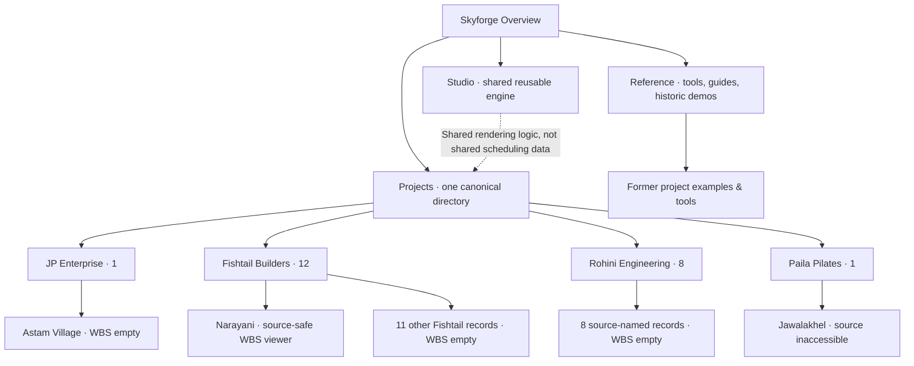
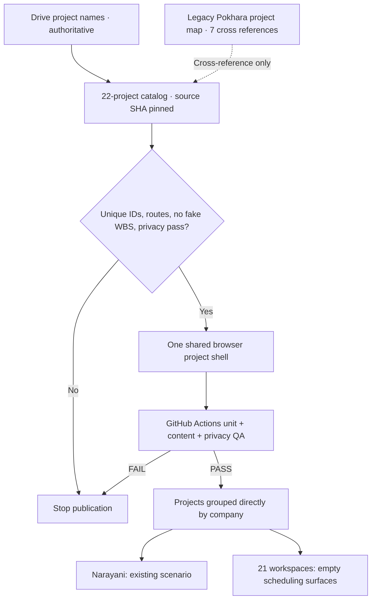

# Skyforge Projects — Drive-first company directory and navigation QA

**Recorded:** 9 November 2026, Asia/Kathmandu  
**Canonical GitHub source:** `FabinGurung/JP_Scheduling_Work_and_Resources_Management` at `kernel-v0.2-open-source-engines`.  
**Public route:** `/projects/` — the ONLY project directory and entrypoint.

## Owner decisions applied

1. The existing `01_JP` Google Drive storage tree and original source/project names have precedence over earlier chat-created names, typographical guesses or the seven-entry Pokhara map snapshot.
2. Use four company groups **directly under Projects**: JP Enterprise; Fishtail Builders; Rohini Engineering and Builders; Paila Pilates.
3. Preserve existing `PORT-000001..PORT-000011` instance IDs, create `PORT-000012..PORT-000022` for newly found Drive project folders, and preserve verified `PRJ-...` identifiers. A `PORT` ID is only a unique site registration ID, not a replacement for source `PRJ` identity.
4. No synthetic project WBS, task dependencies, Gantt, calendar, actual completions or approved construction release should appear for any project lacking the source. All such surfaces are intentionally empty.
5. Narayani's existing 45-activity public-safe viewer remains accessible from its company project page; it is a planning scenario, not actual approved work.
6. Pilot private Google sign-in, signer provisioning and actual field evidence admission remain **PAUSED** per owner.
7. The former `/projects/portfolio/` route is legacy. Redirect it and all 11 former child pages to the current paths. Preserve the previous registry under `docs/archive/20261109_SKYFORGE_PORTFOLIO_V1_REGISTRY.json`; the legacy public JSON is now only a non-authoritative pointer.
8. Move no new source documents, and do not alter existing company/project Drive folder IDs or permissions.

## Verified company and project identities

| Instance | Company | Source-preferred display | Original Drive project-folder title | PRJ source ID | Schedule state |
|---|---|---|---|---|---|
| PORT-000022 | JP Enterprise | Astam Village · Naren Gurung | `Astam Village_Naren Gurung` | — | Empty WBS |
| PORT-000001 | Fishtail Builders | Narayani Parajuli Residence | `Narayani_Parajuli_Residence` | PRJ-000007 | Public-safe scenario |
| PORT-000002 | Fishtail Builders | 17 Samir Man Gubhaju | `PRJ-000002__FBL-001__17_Samir_Man_Gubhaju` | PRJ-000002 | Empty WBS |
| PORT-000003 | Fishtail Builders | 14 Kharika Paudel | `PRJ-000020__FBL-019__14_Kharika_Paudel` | PRJ-000020 | Empty WBS |
| PORT-000004 | Fishtail Builders | 13 Hari Baral | `PRJ-000003__FBL-002__13_Hari_Baral` | PRJ-000003 | Empty WBS |
| PORT-000005 | Fishtail Builders | Yamuna Pun Residence | `Yamuna_Pun_Residence` | — | Empty WBS |
| PORT-000006 | Fishtail Builders | Sabitri Giri Residence | `Sabitri_Giri_Residence` | — | Empty WBS |
| PORT-000007 | Fishtail Builders | Sharada Adhikari Residence | `Sharada_Adhikari_Residence` | — | Empty WBS |
| PORT-000012 | Fishtail Builders | Subin Supplier Residence | `Subin_Supplier_Residence` | — | Empty WBS |
| PORT-000013 | Fishtail Builders | Hari Thapa Residence | `Hari_Thapa_Residence` | — | Empty WBS |
| PORT-000014 | Fishtail Builders | Harisharan Residence | `Harisharan_Residence` | — | Empty WBS |
| PORT-000015 | Fishtail Builders | Aviskar Hospital | `Aviskar_Hospital` | — | Empty WBS |
| PORT-000016 | Fishtail Builders | Vyas Retreat Hotel Waterproofing | `Vyas_Retreat_Hotel_Waterproofing` | — | Empty WBS |
| PORT-000008 | Rohini Engineering and Builders | Bishal Paija Residence | `Bishal_Paija_Residence` | — | Empty WBS |
| PORT-000009 | Rohini Engineering and Builders | 14 Basanti Poudel Baral | `14_Basanti Poudel Baral` | — | Empty WBS |
| PORT-000010 | Rohini Engineering and Builders | Ashok Adhikari | `Ashok Adhikari` | — | Empty WBS |
| PORT-000017 | Rohini Engineering and Builders | 14 Amrit Rawat | `14_Amrit_Rawat` | — | Empty WBS |
| PORT-000018 | Rohini Engineering and Builders | 14 One Storey House · Ramachandra Devkota | `14_One_Storey_House__Ramachandra_Devkota` | — | Empty WBS |
| PORT-000019 | Rohini Engineering and Builders | 14 Amrit Hardware | `14_Amrit_Hardware` | — | Empty WBS |
| PORT-000020 | Rohini Engineering and Builders | Kumari Gurung Residence | `Kumari_Gurung_Residence` | — | Empty WBS |
| PORT-000021 | Rohini Engineering and Builders | Harka Bahadur Sherchan Renovation | `Harka_Bahadur_Sherchan_Renovation` | — | Empty WBS |
| PORT-000011 | Paila Pilates | Jawalakhel Interior Design | `NO ACCESSIBLE PROJECT FOLDER` | — | Empty WBS |

### Source hierarchy and scope

- `01_JP/07 JP Enterprise` → Astam Village_Naren Gurung.
- `01_JP/03 Fishtail Builders/Projects` → Residential/Pokhara/Wards 07, 13, 14, 15, 16, 17, 30, 31; Residential/Location to confirm (Hari Thapa, Harisharan); Institutional/Aviskar Hospital; Commercial/Hospitality/Vyas Retreat Hotel Waterproofing.
- `01_JP/04 Rohini Engineering and Builders/Projects` → Residential/Pokhara/Ward_14 (seven matched folders) and Renovation/Pokhara/Ward_06 (Harka Bahadur Sherchan). A Ward_07 JSON redirect to Basanti is not counted as another project.
- `01_JP/08 Paila Pilates` → A9 governance pointer folder only. Jawalakhel interior is explicitly requested by owner, but source-operational project files in the Paila-controlled Google account are not accessible; its schedule stays empty. Do not move/replicate the separate operational root.
- `01_JP/03 Fishtail Builders/Projects/Residential/Pokhara/Dummy` contains photos, not another verified project identity; no project shell was invented from that folder.
- The seven-entry Pokhara map snapshot has P001-P007 for Bishal Paija, Samir Man Gubhaju, Hari Baral, Yamuna Pun, Sabitri Giri, Sharada Adhikari and Narayani Parajuli. Map statuses are historical map labels, NOT verified construction progress or releases.
- Source name precedence resolves earlier discrepancies: **Fishtail** not Histel; **14 Basanti Poudel Baral** not speculative Basanta Boral; **Bishal Paija**, **Kharika Paudel**, **Sabitri Giri Residence** and **Yamuna Pun Residence** as in Drive. Old labels remain recoverable from Git history and the archived V1 registry.

## Source / Pages hierarchy

```text
Skyforge/
├── index.html                  # Overview
├── projects/
│   ├── index.html              # CANONICAL: searchable, four-company directory
│   ├── registry.json           # CANONICAL: 22 source-grounded project identities
│   ├── jp/  # JP Enterprise (1)
│   │   ├── index.html
│   │   ├── astam-village-naren-gurung/index.html     # PORT-000022
│   ├── fishtail/  # Fishtail Builders (12)
│   │   ├── index.html
│   │   ├── narayani-parajuli-residence/index.html     # PORT-000001
│   │   ├── 17-samir-man-gubhaju/index.html     # PORT-000002
│   │   ├── 14-kharika-paudel/index.html     # PORT-000003
│   │   ├── 13-hari-baral/index.html     # PORT-000004
│   │   ├── yamuna-pun-residence/index.html     # PORT-000005
│   │   ├── sabitri-giri-residence/index.html     # PORT-000006
│   │   ├── sharada-adhikari-residence/index.html     # PORT-000007
│   │   ├── subin-supplier-residence/index.html     # PORT-000012
│   │   ├── hari-thapa-residence/index.html     # PORT-000013
│   │   ├── harisharan-residence/index.html     # PORT-000014
│   │   ├── aviskar-hospital/index.html     # PORT-000015
│   │   ├── vyas-retreat-hotel-waterproofing/index.html     # PORT-000016
│   ├── rohini/  # Rohini Engineering and Builders (8)
│   │   ├── index.html
│   │   ├── bishal-paija-residence/index.html     # PORT-000008
│   │   ├── 14-basanti-poudel-baral/index.html     # PORT-000009
│   │   ├── ashok-adhikari/index.html     # PORT-000010
│   │   ├── 14-amrit-rawat/index.html     # PORT-000017
│   │   ├── 14-ramachandra-devkota-one-storey/index.html     # PORT-000018
│   │   ├── 14-amrit-hardware/index.html     # PORT-000019
│   │   ├── kumari-gurung-residence/index.html     # PORT-000020
│   │   ├── harka-bahadur-sherchan-renovation/index.html     # PORT-000021
│   ├── paila/  # Paila Pilates (1)
│   │   ├── index.html
│   │   ├── jawalakhel-interior-design/index.html     # PORT-000011
│   ├── narayani/                # existing source-safe visual/readiness
│   ├── uploaded-wbs/            # source-pinned synthetic reference
│   ├── community-clinic/        # synthetic demonstration
│   ├── pedestrian-bridge/       # synthetic demonstration
│   ├── generic/                 # reusable generic viewer
│   └── portfolio/               # 12 COMPATIBILITY REDIRECTS (not second directory)
│       ├── index.html           # redirect to projects/
│       ├── registry.json        # deprecated pointer
│       └── [11 former PORT instance routes] → current company routes
├── studio/                      # reusable engine / template
├── more/
│   ├── index.html               # Reference + engineering tools + history
│   └── legacy-home.html
├── knowledge/ · how/ · machine/ · work-items/
├── assets/project-catalog.css  # compact company-first responsive design
├── src/presentation/project-catalog.mjs  # one shared renderer / strict catalog validation
└── .github/workflows/
    ├── deploy-kernel-v02.yml
    ├── machine-build.yml
    ├── narayani-drive-sync.yml  # paused owner authorization
    └── deploy-construction-knowledge-preview.yml
```

## Mermaid website structure



## Mermaid deployment/QA



## QA acceptance checklist

- [x] Four source-preferred companies and 22 unique project IDs.
- [x] Existing IDs from prior 11-project public registry retained.
- [x] Drive folder names supersede chat guesses; source-map rows remain cross references.
- [x] Canonical `/projects/` company-first structure and four company detail pages.
- [x] Every project page uses one shared renderer and *source-empty* scheduling panels if no WBS.
- [x] Narayani legacy WBS, Constellation and readiness routes preserved separately.
- [x] Old portfolio paths are compatibility redirects; no second current project registry.
- [x] Four-button global navigation: Overview, Projects, Studio, Reference.
- [x] Reference hub separates learning, tools and historical examples.
- [x] Mobile-friendly company cards and real working project search.
- [x] Paila pointer moved earlier under `01_JP`, then renumbered `08 Paila Pilates`; original live Drive folder ID and parent verified; history documented under `docs/audit/20261109_PAILA_POINTER_FOLDER_LINEAGE.md`.
- [ ] Each of the 21 empty schedules needs original project WBS, source digest and dependencies before a project-specific four-view rendering can be activated.
- [ ] Real mobile-browser QA for every new route; automated QA cannot substitute for physical user acceptance.
- [ ] Paila operational project source is separately permissioned and not available.
- [ ] Real engineering approvals/signing remain paused by owner's explicit instruction.

**Operational limit:** A verified project-folder name is not a verified activity source. Do not claim source-derived task progress, map-source actual completion, inspection signoff or READY status from names alone.
