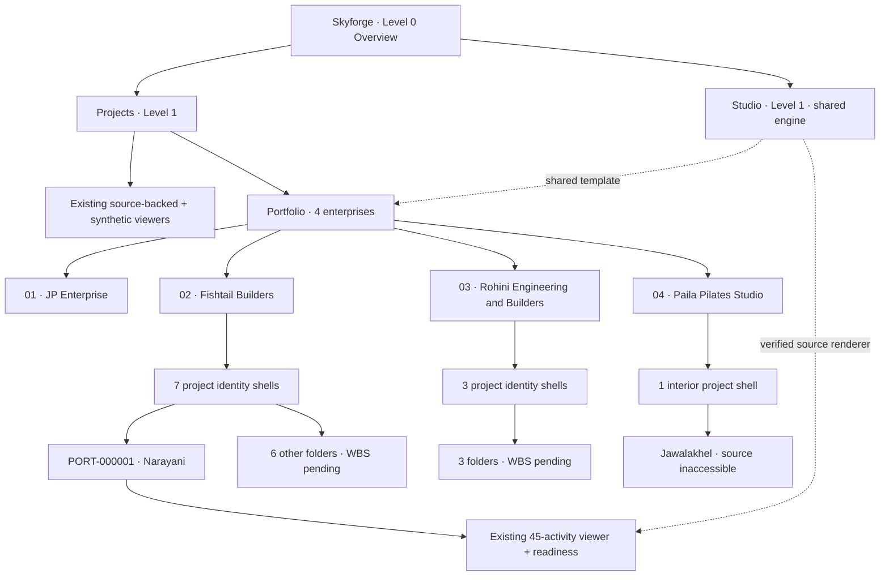

# Skyforge — 4-enterprise project portfolio, Pages/Actions tree and QA

**Audit date:** 9 November 2026 (Asia/Kathmandu)  
**Canonical repository:** `FabinGurung/JP_Scheduling_Work_and_Resources_Management`  
**Production Pages source branch:** `kernel-v0.2-open-source-engines`  
**Mode:** source-honest read-only registry, 11 independently enumerated project identities, shared renderer, NO cloned scheduling quantities.

## Governance decision

Project owner explicitly **paused** private Google sign-in, signing keys, evidence admission and field-release authorization. This milestone is for reusable scheduling-engine QA, enterprise tree reconciliation, source identity, project pages and GitHub Actions only.

**Four enterprises, in the owner's requested logical order:**

1. JP Enterprise — no new project requested under this enterprise.
2. Fishtail Builders — 7 requested project instances. Owner said 'Histel Builders and Private Limited'; original Drive tree says '03 Fishtail Builders'. Legal name/spelling must be confirmed separately.
3. Rohini Engineering and Builders — 3 requested project instances.
4. Paila Pilates Studio — 1 requested interior project. The `13_Paila_Pilates` *federated pointer* folder was moved from the common parent under `01_JP` **without changing its Drive ID or files**; the separate Pilates operational source root was not moved or duplicated.

The source Enterprise Drive folders retain their existing enumeration (`03`, `04`, `07`, `13`); ordinal `ENT-01..04` is the **portfolio index only**, not a Drive rename.

## Individual project QA / naming reconciliation

| Instance ID | Owner-requested label | Verified Drive folder label | Existing project source ID | Identity/source status |
|---|---|---|---|---|
| PORT-000001 | 15 Narayani Parajuli | Narayani_Parajuli_Residence | PRJ-000007 | Existing source-safe 45-activity viewer |
| PORT-000002 | 17 Samirman Gubhaju | PRJ-000002__FBL-001__17_Samir_Man_Gubhaju | PRJ-000002 | Display spelling differs |
| PORT-000003 | 14 Kharika Poudel | PRJ-000020__FBL-019__14_Kharika_Paudel | PRJ-000020 | Display spelling differs |
| PORT-000004 | 13 Hari Baral | PRJ-000003__FBL-002__13_Hari_Baral | PRJ-000003 | Name matched |
| PORT-000005 | 16 Yamuna Pun Adai | Yamuna_Pun_Residence | Not verified | Additional surname not proven |
| PORT-000006 | 30 Dipti Giri / Sabitri Giri | Sabitri_Giri_Residence | Not verified | Two requested people; one source folder |
| PORT-000007 | 31 Sharada Adhikari | Sharada_Adhikari_Residence | Not verified | Name matched |
| PORT-000008 | 14 Bishal Paiza | Bishal_Paija_Residence | Not verified | Display spelling differs |
| PORT-000009 | 14 Basanta Boral Poudel | 14_Basanti Poudel Baral | Not verified | **Potential distinct person — do NOT merge** |
| PORT-000010 | 14 Ashok Adhikari | Ashok Adhikari | Not verified | Name matched |
| PORT-000011 | Interior Design · Jawalakhel, Kathmandu | Operational project source inaccessible | Not verified | Pointer exists, actual project source not authenticated |

**Important:** Portfolio instance IDs `PORT-000001..PORT-000011` are UI/registry IDs, not replacements for authoritative `PRJ-...` project IDs. No new original project folders, Sheets, contracts, completion proofs or work items were invented.

## Full GitHub Pages route tree (44 HTML outputs: 41 unified pages and 3 redirect-only stubs)

```text
https://fabingurung.github.io/JP_Scheduling_Work_and_Resources_Management/
├── index.html                        [Level 0 overview]
├── advanced.html
├── planner.html
├── kernel-lab.html
├── roadmap.html
├── knowledge/
│   ├── index.html
│   ├── task.html
│   ├── shuttering.html
│   ├── waterproofing.html
│   └── soak-pit.html
├── work-items/
│   ├── index.html
│   └── library.json
├── how/
│   ├── index.html
│   └── skyforge-anki.csv
├── studio/                           [Level 1 · reusable engine]
│   ├── index.html
│   └── projects/
│       ├── narayani/index.html
│       ├── community-clinic/index.html
│       └── pedestrian-bridge/index.html
├── projects/                         [Level 1 · independent project records]
│   ├── index.html
│   ├── generic/
│   │   ├── index.html
│   │   ├── community-clinic.json
│   │   ├── pedestrian-bridge.json
│   │   ├── uploaded-wbs.json
│   │   └── manifest.json
│   ├── narayani/
│   │   ├── index.html
│   │   ├── beta.html
│   │   ├── readiness.html
│   │   ├── visual.html
│   │   ├── map.json + manifest.json
│   │   ├── progress.json + progress-manifest.json
│   │   └── project-model.json + visual-manifest.json
│   ├── uploaded-wbs/
│   │   ├── index.html
│   │   └── readiness.html
│   ├── community-clinic/
│   │   ├── index.html
│   │   └── readiness.html
│   ├── pedestrian-bridge/
│   │   ├── index.html
│   │   └── readiness.html
│   └── portfolio/                   [NEW enterprise registry and 11 QA shells]
│       ├── index.html
│       ├── registry.json
│       ├── 15-narayani-parajuli/index.html
│       ├── 17-samirman-gubhaju/index.html
│       ├── 14-kharika-poudel/index.html
│       ├── 13-hari-baral/index.html
│       ├── 16-yamuna-pun-adai/index.html
│       ├── 30-dipti-sabitri-giri/index.html
│       ├── 31-sharada-adhikari/index.html
│       ├── 14-bishal-paiza/index.html
│       ├── 14-basanta-boral-poudel/index.html
│       ├── 14-ashok-adhikari/index.html
│       └── jawalakhel-pilates-interior/index.html
├── machine/
│   ├── index.html
│   ├── demo-foundation/
│   │   ├── index.html
│   │   ├── plan.json
│   │   ├── upstreams.json
│   │   └── manifest.json
│   └── wbs-sample/
│       ├── index.html
│       ├── plan.json
│       ├── activities.csv
│       ├── gantt.svg
│       └── manifest.json
├── more/
│   └── legacy-home.html
├── assets/
│   ├── site-shell.css + site-shell.mjs
│   ├── skyforge-unified.css
│   ├── sky-theme.css + sky-dragon.mjs
│   ├── studio-project.css
│   ├── work-readiness.css
│   └── portfolio.css                [NEW]
└── src/                              [public-safe shared JS modules]
    ├── presentation/
    │   ├── studio-project-page.mjs  [existing viewer]
    │   ├── generic-views.mjs
    │   ├── work-readiness-page.mjs
    │   ├── constellation-zoom.mjs
    │   ├── portfolio-page.mjs       [NEW shared 11-instance UI]
    │   └── other allowlisted browser components
    ├── kernel/                       [public-safe scheduling dependencies]
    ├── visual/
    ├── field/
    ├── machine/
    └── adapters/
```

The `src/` branch contains additional browser-safe modules. The **private** AI source-editing, cryptographic attestation, Drive OAuth and approval simulation modules are deliberately omitted by `scripts/build-public-site.mjs`. Build-time source-route enumeration produces 44 HTML outputs. The GitHub Actions QA log reports 41 **unified/skinned** pages; 3 redirect-only HTML stubs are intentionally excluded from that unified count. Neither count includes downloadable JSON, CSS, JS, CSV or SVG.

## GitHub Actions tree and execution

```text
.github/
└── workflows/
    ├── deploy-kernel-v02.yml
    │   "Site · Validate and Deploy"
    │   └── push to kernel-v0.2-open-source-engines
    │       ├── npm test
    │       ├── verify:calendar
    │       ├── machine:build + machine:verify
    │       ├── wbs:build + wbs:verify
    │       ├── pilot:build + pilot:verify
    │       ├── progress:build + progress:verify
    │       ├── [OPTIONAL, DISABLED] Narayani Google WIF / Sheet sync
    │       ├── visual:build + visual:verify
    │       ├── generic:build + generic:verify
    │       ├── site:build (explicit public allowlist)
    │       ├── validate privacy and project identities
    │       └── configure-pages → upload artifact → deploy-pages
    ├── machine-build.yml
    │   "Tools · Machine Evidence (manual)"
    │   └── workflow_dispatch → approved synthetic fixture → verification
    │       └── reproducible artifact; NO Pages deployment
    ├── narayani-drive-sync.yml
    │   "Ops · Drive Sync (gated)"
    │   └── workflow_call / manual + NARAYANI_SYNC_ENABLED=true
    │       └── read-only Sheets fetch → source/QA → sanitized Pages
    │           [DISABLED BY OWNER FOR NOW]
    └── deploy-construction-knowledge-preview.yml
        "Archive · Knowledge Checks"
        └── legacy validation branch/manual → QA only; NO Pages deployment
```

## Mermaid — website hierarchy



## Mermaid — Actions and authority gates

```mermaid
flowchart TD
  G["Source changes · canonical Git branch"]
  G --> CI["Site · Validate and Deploy"]
  CI --> T["Tests · calendar · deterministic WBS · source digests"]
  T --> Build{"All tests + source/public allowlist pass?"}
  Build -->|Yes| Pages["Deploy 41 unified pages + 3 redirect-only HTML outputs + reviewed assets"]
  Build -->|No| Hold["HOLD · no publication"]
  S["Narayani Drive sync · owner paused"] -. disabled .-> CI
  Man["Manual synthetic machine evidence"] --> Art["Private CI artifact; not Pages"]
  Archive["Legacy knowledge checks"] --> Only["Validation only"]
  Pages --> Site["Read-only public project portfolio"]
  Site --> Unknown["10 portfolios: no WBS · no READY status"]
  Site --> Nar["Narayani: existing public-safe scenario · not actual approval"]
```



## QA checklist — verified vs still open

| Control | Status |
| --- | --- |
| Existing canonical branch and 4 project viewers preserved | DONE |
| Existing Narayani read-only Constellation, Gantt, Calendar and checklists preserved | DONE |
| User-confirmed iPhone Fit / + / − zoom, broader cross-device acceptance | PARTIAL |
| Drive `13_Paila_Pilates` pointer moved into `01_JP`, ID preserved and parent verified | DONE |
| All 11 portfolio identities separately enumerated, one template | DONE |
| Four enterprise groupings displayed in user priority order | DONE |
| Drive name cross-check with aliases and uncertain identities not silently merged | DONE |
| Narayani source-backed project viewer and before/current/after inspector | DONE (planning only) |
| Other 10 project source WBS, real activity inputs and dependency links | WAITING FOR SOURCES |
| Real verified site completion, inspections, permits, signer credentials | PAUSED BY OWNER |
| Actual WBS approval, quantity/progress verification, work release | NOT APPROVED |
| Protected private data omitted from Pages | BUILD/CI CHECKED |
| Independent physical mobile/browser QA for every new page | STILL OPEN |

Do not claim source-verified site readiness or a project-specific Gantt for a project that has no approved/source-backed schedule. The common viewer and dependency engine are *capabilities*, not authority to invent work records.
