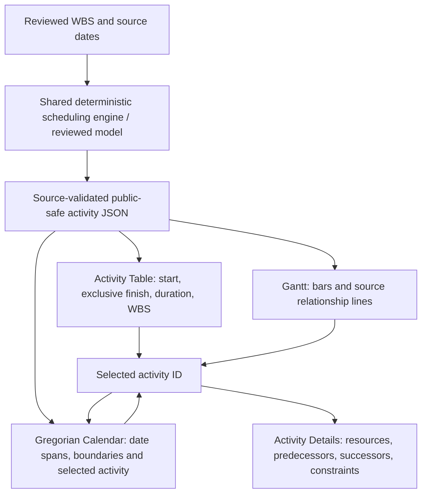

# Skyforge Scheduling Desk — Two Views, One Source Schedule

**Date:** 12 November 2026 · Asia/Kathmandu  
**Repository:** `FabinGurung/jp-scheduling-resources-management`  
**Source branch:** `kernel-v0.2-open-source-engines`  
**Read-only Pages:** https://fabingurung.github.io/jp-scheduling-resources-management/projects/narayani/desk.html

## Owner decision and iPhone QA

The owner provided two iPhone screenshots:
1. The **Before / Current / After** primary view repeated the exact predecessor and successor information already in the bottom *Activity Details → Predecessors* and *Activity Details → Successors* tabs.
2. The 2026 annual calendar looked mostly empty even while the Gantt displayed future activity spans. The user expected every activity's dates to appear in the Gregorian calendar automatically, without duplicate data entry.

**Resolved interface decisions:**
- There are now **only TWO primary tabs**: `Activities + Gantt` and `Year calendar`.
- The separate `Before / Current / After` panel and its standalone primary tab have been removed from the current renderer and project homepage. **Predecessors** and **Successors** remain in the lower Activity Details pane. No dependency records were removed.
- Historic links using `#dependencies` are translated to `#activities`, with the bottom **Predecessors** tab selected. Do not break old distributed links.
- The Calendar is a **projection** of the EXACT SAME validated, source-pinned activity model as the Activity Table/Gantt. No additional calendar JSON, second database or browser entry is required.

## One-source architecture

The source JSON remains read-only on GitHub Pages. A legitimate future **source revision** to task dates, WBS or dependencies through the governed AI/code/review workflow must recompile/re-publish the same validated model: the table, Gantt, and calendar automatically take the new source values on site reload. It would be inaccurate to claim that users can currently edit activity dates directly on GitHub Pages or have them persisted into Google Drive.

## New calendar behaviour

- Month grids contain correct Gregorian 28, 29, 30 or 31-day lengths, including leap years.
- Each date cell counts the **activity date ranges** passing through that day (not merely activity start/finish events), and independently displays source start/finish boundary-event counts.
- A single selected activity ID is shared with the Gantt. Clicking a Gantt activity and opening Calendar **navigates to that activity's start month and year** and highlights its date range. Example: an activity from 20 February 2027 to *exclusive* finish 23 February 2027 highlights 20–22 February and reports 23 February as its finish boundary.
- Calendar includes `Jump to selected activity` and `Open selected in Gantt + details` buttons. Selecting an activity from a calendar day also highlights it in the Gantt and populates the same lower Activity Details pane when returning.
- The user can browse other years without accidentally rewriting source dates.
- No derived date is stored back into the model when switching views.

### Important precision boundary

The source finish is an **exclusive activity boundary**, not an actual site completion timestamp. A Gantt bar spanning dates across holidays does **not** prove crews work on each included date; without a separately verified *project working-time calendar*, the calendar's day count is a **date-span occupancy display**. The UI now says 'planned' / 'date-range spans' instead of claiming confirmed working days or site attendance.

If an activity has `start_date=2027-02-20` and `finish_date=2027-02-23`, its date span includes **20, 21 and 22 February** but **not 23 February**; the finish boundary is still displayed on the 23rd. Zero-duration milestone events remain visible even without occupied workdays.

## Source and QA controls

- Shared client-only renderer: `src/presentation/scheduling-desk.mjs`
- Display styling: `assets/scheduling-desk.css`
- Project homepage: `src/presentation/project-catalog.mjs`
- Tests: `tests/two-view-calendar-sync.test.mjs`, existing `tests/scheduling-desk-productivity.test.mjs`, `tests/enterprise-portfolio.test.mjs`, and prior model-validation/privacy tests.
- Automated tests verify date-range occupancy and finish boundaries, cross-year navigation, leap February, a revised source date changing the calendar projection without touching a second source, legacy `#dependencies` routing, and no public write action.
- Do not re-enable the former constellation or checklist as primary planning views.

## Outstanding D1 QA — real device

- [ ] iPhone Safari: two primary tabs only; former Before/Current/After button gone.
- [ ] In Gantt select **T3020** and open Calendar: see **February 2027** automatically; selected day range is highlighted.
- [ ] Inspect calendar 20–23 Feb 2027 for active span versus exclusive finish boundary; no duplicate date entry.
- [ ] From a calendar day choose another activity and press **Open selected in Gantt + details**; the same activity ID is selected in the table, its resources and predecessor/successor tabs remain.
- [ ] Open an existing old `#dependencies` URL: it must land in Activities + Gantt with lower Predecessors detail rather than a broken or duplicated tab.
- [ ] Verify mobile scrolling and no overflow in days with start/finish events.

**Remaining project-governance debt:** approved construction baselines, verified work calendars, actual source resource assignments/materials, source revision admission and authenticated field evidence. The owner previously paused private sign-in and signing, so these are outside this UI-only change.
